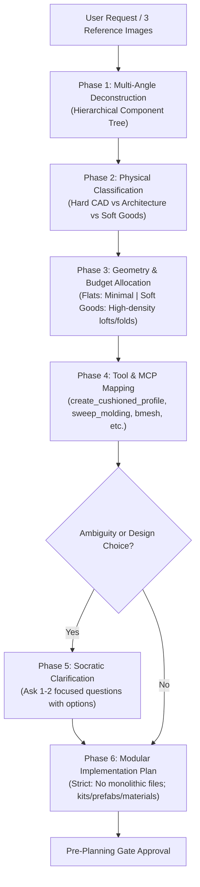

# Design Specification: Blender Universal Spatial Thinking & Modular Planning Skill

**Date**: 2026-11-13  
**Status**: Approved / In-Design  
**Target Path**: `docs/superpowers/specs/2026-11-13-blender-spatial-thinking-skill-design.md`  

---

## 1. Intent & Problem Statement

### 1.1 The Problem
When users ask AI agents (connected to Blender via MCP) to create 3D assets or scenes:
1. **The Boxy Fallacy**: The AI defaults to naive primitives (cubes, cylinders, flat extrusions) without natural curvature, crowning, or organic feel.
2. **Reference Blindness**: Even when the user provides 3 reference images (front, side, top/perspective), the agent fails to align datum planes, evaluate cross-sections, or reproduce the silhouette.
3. **Geometry Misallocation**:
   - **Architectural / Flat Surfaces**: The agent wastes geometry by applying heavy subdivisions or complex procedural nodes to flat walls, floors, or tabletops.
   - **Soft Goods / Organic Surfaces**: The agent starves pliable elements (pillows, cushions, bedspreads, clothing, curtains). It does not understand the anatomy of a pillow (pinched corners, lofted convex belly, perimeter seam line, tension folds) and produces rigid, chamfered bricks.
4. **Tool & MCP Feature Blindness**: The agent does not know what specialized tools exist in the Blender MCP server (e.g., `create_cushioned_profile`, `create_architectural_wall`, `create_profile_sweep_molding`, `setup_subdivision_cage`, `clas_loft_splines`, `clas_boolean_carve`, `apply_uv_unwrap`) and fails to map components to the right tool.
5. **Monolithic Script Antipattern**: The agent writes giant 1,000-line monolithic scripts that freeze Blender, fail silently, or make surgical edits impossible.

### 1.2 Synthesis of 9 Blender Tutorials (Core Principles)
The 9 video tutorials provide the exact technical foundation needed to correct these failures:
1. **Passes & Form Hierarchy (CG Cookie)**: Primary (silhouette/blocking) → Secondary (beveled cuts/forms) → Tertiary (wrinkles, seams, bolts). Scale discipline (Ctrl+A Scale). Non-destructive modifiers (`Solidify`, `Mirror`). Alt+D linked instances with random variations.
2. **Reference Tracing & Organic Sub-D (Blender Breakdown)**: 3-angle reference setup, face-project snapping for retopology, subdivision cage + sculpt mode (smooth/grab) for organic softness.
3. **Precision CAD & Coordinate Alignment (3D Nato)**: Millimeter units, exact coordinate transforms (`Shift+D X 40`), LoopTools Circle for round apertures, Bridge Edge Loops.
4. **Pre-Boolean Uniform Grid & Shrinkwrap Shading Fix (Casper 3D)**: Adding uniform grid cuts before boolean operations; converting N-gons to quads; using Shrinkwrap modifier on vertex groups to eliminate curvature shading artifacts.
5. **Asset & Scale Hygiene (BlenderVitals)**: Avoiding the scale domino effect; strict outliner naming (banning `Cube.001..057`); modular organization with prefabs/collections.
6. **Fundamentals Over ADHD (Kaizen)**: Focusing on fundamental topology, edge flow, and UVs rather than jumping randomly between features.
7. **Comprehensive Tool Mastery (CG Aman)**: LoopTools, Node Wrangler, Modifier combinations (`Sub-D`, `Solidify`, `Array` with Object Offset, `Bevel Weight`), Gobos, Light linking, Nishita sky.
8. **Boolean Topology Discipline (CG Loop)**: Pre-cutting meshes with dense loop cuts before boolean subtraction; accepting triangles on flat surfaces while keeping poles off curved surfaces.
9. **Curves & Proportional Modeling (EVIL ROX ANIMATION)**: LoopTools circle for sockets; Proportional editing (`O` with Connected Only); Bezier curves with Bevel Objects and `Alt+S` radius tapering for hair strands, cables, and pipes.

---

## 2. Solution: Universal Spatial Thinking & Modular Planning Skill

We will implement a dedicated skill: `skills/blender-spatial-thinking-planner/` that enforces an autonomous, 6-phase cognitive workflow before any 3D code is executed.

### 2.1 The 6 Cognitive Phases



### 2.2 Phase Details

1. **Phase 1: Multi-Angle Reference & Domain Deconstruction**
   - Deconstruct the model into primary assemblies and sub-components.
   - Align Front, Side, and Top datum planes.
   - Prevent monolithic assumptions.

2. **Phase 2: Physical & Material Classification**
   - **Type A: Architectural Envelope** (Walls, floors, ceilings, window reveals): Rigid, planar, requires exact dimensions, corners with bevel/molding, ZERO dense subdivision on flat spans.
   - **Type B: Hard-Surface / Mechanical CAD** (Frames, legs, brackets, electronics, dials): Accurate millimeter dimensions, pre-boolean uniform grids, quad cleanup, chamfers, bevel weights.
   - **Type C: Organic Soft Goods & Fabric** (Pillows, cushions, mattresses, blankets, curtains, upholstery): Non-rigid, convex lofting, pinched corner seams, perimeter welt/piping, gravity drape, high-density smooth quad flow, subdivision cage.
   - **Type D: Slender Curved Extrusions** (Pipes, cables, hair locks, decorative trims): Bezier splines with bevel depth/objects, `Alt+S` tapering.

3. **Phase 3: Geometry & Budget Allocation Matrix**
   - Strictly ban wasteful subdivision on planar walls.
   - Mandate proper geometry on cushions/pillows:
     - Pillow Anatomy:
       - **Perimeter Seam Loop**: Outer boundary at baseline $Z_0$.
       - **Convex Parabolic Loft**: Belly rises to maximum crown height $Z_0 + h_{crown}$ at center $(u=0, v=0)$ via $Z(u,v) = Z_0 + h_{crown} \cdot (1 - u^2)(1 - v^2)$.
       - **Pinched Corners**: Creases pulled tight at corners $(u=\pm 1, v=\pm 1)$.
       - **Subdivision Cage**: Minimum 8x8 or 12x12 quad grid with Level 2 Sub-D and Smooth Shading.

4. **Phase 4: Live MCP & Native Tool Selection Matrix**
   - `create_architectural_wall`: Walls with exact window/door cutouts.
   - `create_profile_sweep_molding`: Baseboards, crown moldings, wainscoting along paths.
   - `create_cushioned_profile`: Pillows, sofa cushions, tufted headboards.
   - `setup_subdivision_cage`: Soft goods smoothing with edge crease protection.
   - `create_bezier_tube`: Cables, pipes, stylized hair strands with taper.
   - `clas_loft_splines`: Complex aerodynamic/organic lofting.
   - `audit_mesh_topology`: Topology and manifold validation.
   - `apply_uv_unwrap`: Automatic seams and UV unwrap.
   - BMesh Zone A (90%): In-memory procedural generation.
   - Modifiers: Shrinkwrap for shading fix, Solidify with vertex groups, Mirror with clipping.

5. **Phase 5: Clarification & Questioning Gate**
   - If user input is ambiguous or offers multiple valid aesthetics (e.g. tufted vs plain modern cushion; recessed vs surface-mounted baseboard), ask 1-2 focused questions with clear options before generating code.

6. **Phase 6: Modular Code Architecture Mandate**
   - **STRICT BAN ON MONOLITHIC FILES**.
   - Assets must be split into:
     - `core/materials.py`: Shared PBR materials and procedural node setups.
     - `core/mesh_utils.py`: Reusable bmesh helpers, transform tools.
     - `prefabs/<component>_kit.py`: Component generators (e.g. `arch_kit.py`, `bed_kit.py`, `cushion_kit.py`).
     - `main.py`: Scene assembler using `Alt+D` shared instancing and single-buffer bmesh merging.

---

## 3. Deliverables & Directory Structure

```
skills/
└── blender-spatial-thinking-planner/
    ├── SKILL.md
    ├── references/
    │   ├── spatial-deconstruction-and-geometry-allocation-playbook.md
    │   ├── mcp-and-blender-tool-selection-matrix.md
    │   └── modular-code-architecture-playbook.md
    └── templates/
        └── spatial-execution-plan-template.md

tests/
└── test_spatial_thinking_planner_skill.py
```

---

## 4. Verification Criteria

1. Skill files created with valid frontmatter and cross-links.
2. The 9 video principles explicitly embedded in playbooks.
3. Unit test verifying:
   - Skill discoverability and schema validity.
   - Spatial deconstruction heuristics (Wall vs Pillow classification).
   - Tool mapping accuracy.
   - Modular file structure enforcement rules.
