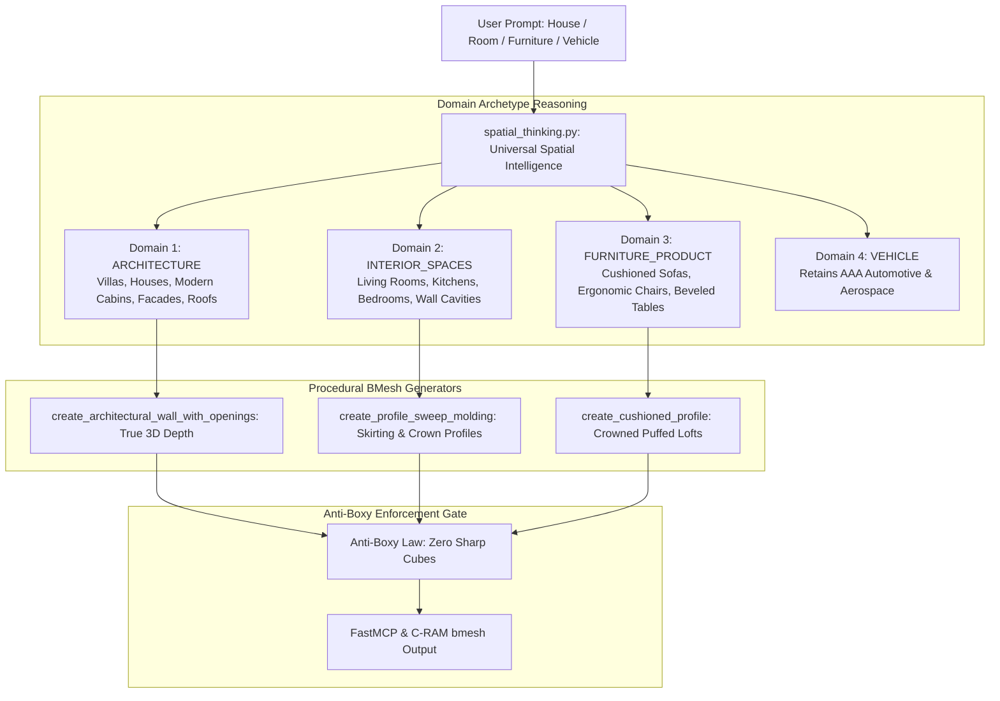

# Design Specification: Universal Spatial & Architectural Intelligence Engine

**Date**: 2026-11-13  
**Status**: Pending Review  
**Target Path**: `docs/superpowers/specs/2026-11-13-universal-spatial-intelligence-design.md`  

---

## 1. Intent & Problem Statement

### The Problem: Automotive/Gaming Bias & "Lazy Boxy Collapse"
1. **Automotive Hyper-Focus**: The existing engine heuristics are concentrated in `vehicle_thinking.py`, hardcoded for cars, vans, and trucks. When asked for architecture, interior rooms, furniture, or everyday props, `get_component_tree()` falls back to `"main_chassis"` and `"body_shell"`.
2. **Cognitive Pressure Absence (Lazy Boxy Collapse)**: Without enforced architectural and ergonomic spatial rules, LLM agents default to the path of least resistance: gluing together unfilleted 90-degree boxes (`make_box`). Sofas become wooden blocks, rooms become paper-thin box enclosures, and houses become featureless cubes with zero wall thickness, reveal depth, or moldings.
3. **Zero-Fillet Fallacy**: Nothing in the physical world has $0\,\text{mm}$ razor-sharp edges. Wood has $2\text{--}4\,\text{mm}$ roundovers, machined metal has $0.5\text{--}1.5\,\text{mm}$ chamfers, and upholstered furniture has $20\text{--}60\,\text{mm}$ crowned curves.

### The Solution
Transform the single-domain engine into a **Universal Spatial & Architectural Intelligence Engine** (`spatial_thinking.py`) and equip `bmesh_toolkit` with ergonomic and architectural curve generators that force the AI to reason about:
- **Architectural Datums**: Wall thickness ($\ge 0.2\,\text{m}$), window reveal depth ($\ge 0.15\,\text{m}$), door heights ($2.1\,\text{m}$), ceiling drops, and sill projections.
- **Ergonomic Furniture Geometry**: Crowned cushion lofts, angled seat/back planes ($100^\circ\text{--}105^\circ$), contoured armrests, and tapered round legs.
- **Layered Construction**: Floor slab $\to$ Framed cavity wall $\to$ Architraves/casing $\to$ Skirting boards & crown moldings $\to$ Lighting coves.

---

## 2. Core Architecture & Domains

---

## 3. Detailed Domain Specifications

### Domain 1: `ARCHITECTURE` (Houses, Buildings, Facades, Roofs)
- **Standard Datums**:
  - Exterior wall thickness: $0.20\,\text{m}$ to $0.35\,\text{m}$ (double-leaf brick / insulated stud).
  - Interior partition thickness: $0.10\,\text{m}$ to $0.15\,\text{m}$.
  - Floor-to-ceiling clear height: $2.80\,\text{m}$ to $3.50\,\text{m}$.
  - Window sill height: $0.85\,\text{m}$ to $0.90\,\text{m}$.
  - Door frame opening: $0.90\,\text{m} \times 2.10\,\text{m}$.
  - Eaves overhang: $0.40\,\text{m}$ to $0.80\,\text{m}$.
- **Component Breakdown**:
  - `foundation_slab`: Concrete footings and floor ground slab.
  - `structural_walls`: Exterior walls with genuine recessed window/door openings.
  - `roof_structure`: Gable, hip, shed, or flat parapet with fascia board and soffit.
  - `fenestration`: Window frames with mullions, double glazing, and exterior drip sills.
  - `architectural_trim`: Corner quoining, lintel beams, porch columns, and entry steps.

### Domain 2: `INTERIOR_SPACES` (Living Rooms, Bedrooms, Kitchens)
- **Standard Datums**:
  - Skirting board (baseboard) height: $0.10\,\text{m}$ to $0.15\,\text{m}$ with profiled top roundover.
  - Crown molding (cornice): $0.08\,\text{m} \times 0.08\,\text{m}$ cove/cyma profile at ceiling junction.
  - Ceiling tray/drop: $0.15\,\text{m}$ drop with $0.05\,\text{m}$ recessed LED cove.
  - Flooring: Parquet / tile grid with micro-gaps ($1\text{--}2\,\text{mm}$) and tactile texture indices.
- **Component Breakdown**:
  - `room_envelope`: Enclosed floor, walls with openings, and ceiling tray.
  - `trim_carpentry`: Skirting boards, crown moldings, door casings/architraves.
  - `ambient_lighting`: Recessed pot lights, LED cove troughs, pendant drops.

### Domain 3: `FURNITURE_PRODUCT` (Upholstery, Chairs, Tables, Fixtures)
- **Standard Datums & Curvature Rules**:
  - Sofa seat height: $0.42\,\text{m}$ to $0.46\,\text{m}$; seat depth: $0.55\,\text{m}$ to $0.65\,\text{m}$.
  - Seat cushion crown: $+0.04\,\text{m}$ parabolic upward dome (never a flat top).
  - Backrest inclination: $100^\circ$ to $108^\circ$ recline; lumbar support crown: $+0.03\,\text{m}$.
  - Table top bevel: $3\,\text{mm}$ to $8\,\text{mm}$ chamfer or bullnose roundover.
  - Chair leg taper: $45\,\text{mm}$ top to $25\,\text{mm}$ bottom with foot glides.
- **Component Breakdown**:
  - `cushion_assemblies`: Multi-segment lofted quad cushions with perimeter piping/seams.
  - `frame_and_chassis`: Internal hardwood frame, armrest profiles, back shell.
  - `support_legs`: Turned wooden legs, metal sled bases, or hairpin steel legs.

### Domain 4: `VEHICLE` (Automotive, Aerospace, Marine)
- Retains existing high-precision formulas (`AMBULANCE_VAN`, `SPORTS_COUPE`, `SEDAN`, `SUV`, `TRUCK`).

---

## 4. New Procedural BMesh Toolkit Generators

### 1. `create_cushioned_profile(width, depth, thickness, crown_height=0.04, segments=12)`
Generates an organic, puffed quad cushion using a 2D grid displaced by a double-parabolic dome equation:
$$Z(u, v) = Z_0 + \text{crown} \cdot (1 - u^2)(1 - v^2)$$
with rounded perimeter pillowed edges. Eliminates flat-slab sofa syndrome.

### 2. `create_architectural_wall_with_openings(length, height, thickness=0.25, openings=[...])`
Constructs a watertight, manifold wall with real thickness and cutout cavities for windows and doors, automatically adding lintels, jambs, and sloped sills.

### 3. `create_profile_sweep_molding(path_points, profile_type="BASEBOARD"|"CROWN_MOLDING"|"CASING")`
Extrudes a classic architectural profile (cyma recta, ovolo, torus baseboard) along an interior room perimeter path using non-destructive Bezier curve geometry.

---

## 5. Anti-Boxy Spatial Law (Gate Enforcement)

The **Zero Unfilleted Primitives Law** is added to `skills/blender-geometry-engineering`:
> Any furniture, product, or architectural element represented as a raw, sharp-edged cube without edge fillets, bevels, wall reveals, or ergonomic crowning is **REJECTED AT GATE G2**.

---

## 6. Verification Plan

1. **Unit Tests**:
   - `test_spatial_thinking_architecture_archetypes`: Verifies dimensions for villas, houses, rooms, and sofas.
   - `test_get_component_tree_universal`: Verifies component trees for `ARCHITECTURE`, `INTERIOR`, `FURNITURE`, and `VEHICLE`.
   - `test_cushioned_profile_generation`: Verifies quad-dominant non-flat cushion mesh.
   - `test_architectural_wall_generation`: Verifies watertight wall with window reveal cavity.
2. **Regression Suite**:
   - Ensure all 29 existing engine tests continue to pass 100% green.
